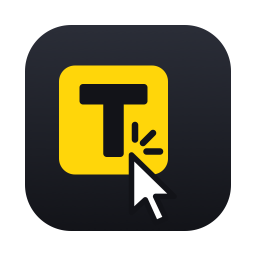

<p align="center"></p>

# ClickSub

Local-first AI subtitles for DaVinci Resolve, Adobe Premiere Pro and After Effects, or as a standalone app. No cloud, no subscription, nothing leaves your machine.

Transcribe in 1,000+ languages with speaker labels, then send animated captions straight to your timeline. On top of that:

- 🗣️ **Hinglish:** Hindi and Urdu speech written in everyday Roman spellings ("baaz log", "mental health ka theek na hona"), with English words spelled as English.
- 🧱 **Stacked captions:** phrases build up line by line, each line on its own track with its own font, size, blend mode and opacity.
- ✨ **Luxury presets:** font pairings and blend modes chosen to look good together, with animation controls in Resolve's own Text+ inspector.
- 📐 **One size and position for every caption:** resize or move all captions on the timeline at once.
- ✍️ **Your corrections reach Resolve:** captions you fix in the app are placed with your text, and word animations keep their timing.

In DaVinci Resolve, ClickSub runs from **Workspace → Scripts → ClickSub**.

## Install

There are no prebuilt installers yet, so build it from source:

```bash
git clone https://github.com/Haiderboss/ClickSub.git
cd ClickSub/AutoSubs-App
npm install
npm run dev
```

See [CONTRIBUTING.md](CONTRIBUTING.md) for the requirements (Node, Rust) and [Resolve-Integration/README.md](Resolve-Integration/README.md) for connecting to DaVinci Resolve.

---

## Quick Start

### Standalone Mode
1. Launch ClickSub and select an audio or video file.
2. Pick your model and language/translation options.
3. Click **Transcribe**. Edit speakers and subtitles as needed.
4. Export as SRT, text, or copy to clipboard.

### DaVinci Resolve Mode
1. Open DaVinci Resolve → **Workspace → Scripts → ClickSub**.
2. Select your timeline/audio source and settings.
3. Click **Transcribe**. Edit speakers and subtitles as needed.
4. Send styled subtitles back to Resolve.

> [!WARNING]
> Mac App Store version not supported - download DaVinci Resolve from [blackmagicdesign.com](https://www.blackmagicdesign.com/products/davinciresolve/) instead.

### Adobe Premiere Pro / After Effects Mode
1. Launch ClickSub and open Premiere Pro or After Effects (the CEP extension loads automatically).
2. Select the Adobe integration from ClickSub to export timeline audio for transcription, or import generated subtitles into your project.
3. In Premiere Pro, subtitles are imported as caption tracks; in After Effects, SRT entries are created as text layers.

### Command Line Interface

For command-line usage, see the **[CLI Guide](CLI.md)** with complete reference, examples, and troubleshooting.

---

## Documentation

- **[CLI Guide](CLI.md)** - Command-line interface reference
- **[Contributing Guide](CONTRIBUTING.md)** - Development setup and contribution workflow
- **[AutoSubs-App README](AutoSubs-App/README.md)** - Technical architecture and code organization
- **[Resolve Integration](Resolve-Integration/README.md)** - DaVinci Resolve integration architecture and development
- **[Adobe Extension](Adobe-Extension/README.md)** - Adobe Premiere Pro/After Effects integration details
- **[Arch Linux](docs/arch-linux.md)** - Dependencies, Wayland compositing, and Resolve paths on Arch

---

## Supported Models

ClickSub ships with several local transcription model families. All run fully on-device — nothing is sent to the cloud. Models are downloaded on demand from the in-app Model Manager.

> Accuracy is a relative 1–4 rating within ClickSub (higher is better). Sizes and RAM figures are approximate.

### Whisper

OpenAI's Whisper, via `whisper-rs` (GGML). Each size is available in a multilingual variant and an `.en` English-only variant (the `.en` models are slightly more accurate on English audio).

| Model | Size | RAM | Languages | Accuracy |
|---|---|---|---|---|
| tiny / tiny.en | 80 MB | 1 GB | Multilingual / English | ★ |
| base / base.en | 150 MB | 1 GB | Multilingual / English | ★ |
| small / small.en | 480 MB | 2 GB | Multilingual / English | ★★ |
| medium / medium.en | 1.5 GB | 5 GB | Multilingual / English | ★★★ |
| large-v3-turbo | 1.6 GB | 6 GB | Multilingual | ★★★ |
| large-v3 | 3.1 GB | 10 GB | Multilingual | ★★★★ |

### Moonshine

Useful Sensors' Moonshine, via ONNX Runtime. The `tiny` English model is quantized; the language-specific `tiny` variants and the `base` model are float-precision.

| Model | Size | RAM | Language | Accuracy |
|---|---|---|---|---|
| moonshine-tiny | 60 MB | 1 GB | English | ★ |
| moonshine-tiny-ar | 120 MB | 1 GB | Arabic | ★★★ |
| moonshine-tiny-zh | 120 MB | 1 GB | Chinese | ★★★ |
| moonshine-tiny-ja | 120 MB | 1 GB | Japanese | ★★★ |
| moonshine-tiny-ko | 120 MB | 1 GB | Korean | ★★★ |
| moonshine-tiny-uk | 120 MB | 1 GB | Ukrainian | ★★ |
| moonshine-tiny-vi | 120 MB | 1 GB | Vietnamese | ★★★ |
| moonshine-base | 200 MB | 1 GB | English | ★★ |

### Parakeet

NVIDIA's Parakeet-TDT-0.6B-v3 (int8 ONNX). Fast and accurate, with support for 25 European languages plus Russian and Ukrainian. Orukeet is a community variant on the same engine — faster and more accurate than Parakeet, with weights under CC BY-SA 4.0.

| Model | Size | RAM | Languages | Accuracy |
|---|---|---|---|---|
| orukeet | 672 MB | 4 GB | 25 languages (EU + RU + UK) | ★★★★ |
| parakeet | 700 MB | 2 GB | 25 languages (EU + RU + UK) | ★★★★ |

### SenseVoice

Alibaba's SenseVoice (int8 ONNX). Compact and well-suited to CJK audio.

| Model | Size | RAM | Languages | Accuracy |
|---|---|---|---|---|
| sense-voice | 230 MB | 1 GB | Chinese, English, Japanese, Korean, Cantonese | ★★★ |

### Canary

NVIDIA's Canary-1B-v2 (int8 ONNX). A multilingual encoder-decoder model that also supports native translation.

| Model | Size | RAM | Languages | Accuracy |
|---|---|---|---|---|
| canary | 1 GB | 3 GB | 25 languages (EU + RU + UK) | ★★★★ |

### Cohere

Cohere Transcribe (int4 ONNX). The highest-accuracy option for a focused set of 14 widely-spoken languages.

| Model | Size | RAM | Languages | Accuracy |
|---|---|---|---|---|
| cohere | 2 GB | 4 GB | Arabic, German, Greek, English, Spanish, French, Italian, Japanese, Korean, Dutch, Polish, Portuguese, Vietnamese, Chinese | ★★★★ |

### GigaAM

Sber's GigaAM v3 (int8 ONNX). A Conformer model trained on 700k hours of Russian speech — the most accurate option for Russian audio. The end-to-end CTC variant outputs punctuated, normalized text.

| Model | Size | RAM | Languages | Accuracy |
|---|---|---|---|---|
| gigaam-v3 | 225 MB | 2 GB | Russian, English | ★★★★ |

GigaAM Multilingual (600M, int8 ONNX) covers Central Asian languages that the other models handle poorly — Whisper large v3 scores 58–110% WER on Kazakh, Kyrgyz and Uzbek. It uses a character-wise CTC head, so unlike GigaAM v3 its output has no punctuation or capitalization.

| Model | Size | RAM | Languages | Accuracy |
|---|---|---|---|---|
| gigaam-multilingual | 592 MB | 3 GB | Russian, Kazakh, Kyrgyz, Uzbek, English | ★★★★ |

### Omni-ASR

Meta's Omnilingual ASR (1B CTC, fp32 ONNX). Covers 1600+ languages, making it the fallback for languages no specialist model supports. Output is lowercase with no punctuation.

| Model | Size | RAM | Languages | Accuracy |
|---|---|---|---|---|
| omni-asr-1b-ctc | 3.7 GB | 4 GB | 1600+ languages | ★★★ |

### Diarization & VAD

In addition to transcription models, ClickSub downloads a speaker diarization model (~40 MB, user-selectable from the Model Manager) and a Silero VAD model (auto-downloaded for voice activity detection during transcription). An optional MMS forced-alignment model (~320 MB, CC BY-NC 4.0) can also be downloaded for word-level timestamps — see [Model licensing](#model-licensing).

---

## Integrations

ClickSub can run as a standalone subtitle generator, connect directly to DaVinci Resolve, or communicate with Adobe Premiere Pro and After Effects through the bundled CEP extension.

Select a Preset Style |  Or create your own
:-------------------------:|:-------------------------:
 | 

---

## Contributing

PRs are welcome! See [CONTRIBUTING.md](CONTRIBUTING.md) for how to get started, including the dev setup.

For detailed information about the DaVinci Resolve integration architecture, Lua server, Fusion macro system, and development workflow, see [Resolve-Integration/README.md](Resolve-Integration/README.md).

---

## Model licensing

ClickSub code is MIT-licensed. The optional MMS forced-alignment weights are downloaded separately and licensed under [CC BY-NC 4.0](https://creativecommons.org/licenses/by-nc/4.0/) for noncommercial use. Users are responsible for ensuring their use complies with the model license.

The forced-aligner weights originate from Meta's MMS model, with forced-alignment conversion work by MahmoudAshraf and ONNX/INT8 conversion by [onnx-community](https://huggingface.co/onnx-community/mms-300m-1130-forced-aligner-ONNX). Conversion and quantization changes were made by those respective projects; no endorsement is implied.

While MMS supports over a thousand languages, word-level alignment relies on romanizing the transcript with [uroman](https://github.com/o24s/uroman-rs). uroman covers the major world scripts (Latin, Cyrillic, Arabic, CJK, most Indic scripts, etc.), but very low-resource minority languages whose scripts are not included in its data may produce degraded or missing word timestamps.

## Acknowledgments

ClickSub is built on top of excellent open-source projects:

- [AutoSubs](https://github.com/tmoroney/auto-subs) by Tom Moroney (MIT license) - the original project ClickSub is built on
- [whisper-rs](https://codeberg.org/tazz4843/whisper-rs) - Rust bindings for Whisper C++ library
- [transcribe-rs](https://github.com/cjpais/transcribe-rs) - ONNX Runtime transcription with Moonshine and Parakeet models
- [pyannote-rs](https://github.com/thewh1teagle/pyannote-rs) - Rust implementation of Pyannote for speaker diarization (integrated into app code for improvements)
